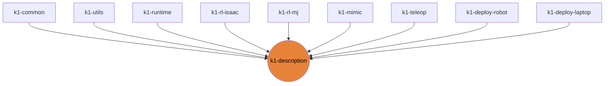

# k1-description

K1 URDF / MJCF / USD description (ROS 2 package); meshes come from the booster_assets submodule.

| | |
|---|---|
| Layer | **L0**: Contract (no heavy deps) |
| May import | nothing |
| Files / LOC | 172 files · 316 lines (py, sh, cpp) |
| Part of | [k1-workspace](https://github.com/thdhyan/k1-workspace) (architecture and layering rules live there) |

## Where it sits



Used by: k1-common, k1-utils, k1-runtime, k1-rl-isaac, k1-rl-mj, k1-mimic, k1-teleop, k1-deploy-robot, k1-deploy-laptop.


## Install

```bash
uv add git+https://github.com/thdhyan/k1-description
# or, from a checkout
uv sync
```

## Usage

Owns every robot model file. No other library computes model paths itself: they all ask this one.

```python
import k1_description as d
d.robot_file(d.URDF)        # K1_22dof.urdf;  also URDF_ZED, MJCF, MJCF_MJLAB, MJCF_MJLAB_ARMS
d.robot_file(d.USD_MJLAB)   # usd_mjlab/ USD for Isaac mjlab-asset tasks; also USD_MJLAB_ARMS, USD_MJLAB_SOLID
d.assets_dir()              # $K1_ASSETS_DIR, else the bundled assets/ (booster_assets submodule)
d.robot_description()       # URDF text for robot_state_publisher
```
The meshes, MJCF and USD come from the nested `assets/` submodule (booster_assets). Fetch them with
`git submodule update --init assets`, or let `scripts/dev-install.sh` do it.

As a ROS 2 package (installs `share/k1_description/assets/robots/K1`):
```bash
source /opt/ros/jazzy/setup.bash
ros2 launch k1_description view_robot.launch.py   # RSP + joint_state_publisher_gui + RViz
```

## Tests

From a k1-workspace checkout (see its README, "Run the tests"):
```bash
cd libs/k1-description && python -m pytest -q tests
```

## Robots and hosts

Robot IPs, SSH aliases, network, safety and how to control each robot: [docs/ROBOTS.md](https://github.com/thdhyan/k1-workspace/blob/main/docs/ROBOTS.md) in k1-workspace.

## Environment variables read

`K1_ASSETS_DIR`, `K1_JOINT_NAMES`

## Layout

```
CMakeLists.txt
README.md
assets/  (166 files)
  K1_22dof.urdf
  LICENSE
  README.md
  motions/  (2 files)
  pyproject.toml
  robots/  (155 files)
  setup.cfg
  src/  (2 files)
config/  (2 files)
  k1_controllers.yaml
  ros2_control.yaml
launch/  (1 files)
  view_robot.launch.py
package.xml
pyproject.toml
scripts/  (1 files)
  generate_k1_urdf.py
src/  (2 files)
  k1_description/  (2 files)
tests/  (2 files)
  test_assets.py
urdf/  (1 files)
  k1_gz.urdf.xacro
```

## Dependencies

- Declared sibling libraries: none (see `pyproject.toml`, `[tool.uv.sources]`).
- PyPI: pytest.
- Provided by the environment (ROS 2, Isaac, mjlab, robot SDK) or unresolved: `ament_index_python`, `launch`, `launch_ros`.

## Hard-coded paths into other repos

None.

## Origin

Extracted from `booster_ws` (branch `dev/push-training-wip`, working tree of 2026-11-03) by
`tools/build_workspace.py` in k1-workspace. Old path to new path for every file: [`docs/migration_map.tsv`](https://github.com/thdhyan/k1-workspace/blob/main/docs/migration_map.tsv) (filter on `k1-description`).
History was not carried over: the working tree was copied as is, including previously untracked files.
